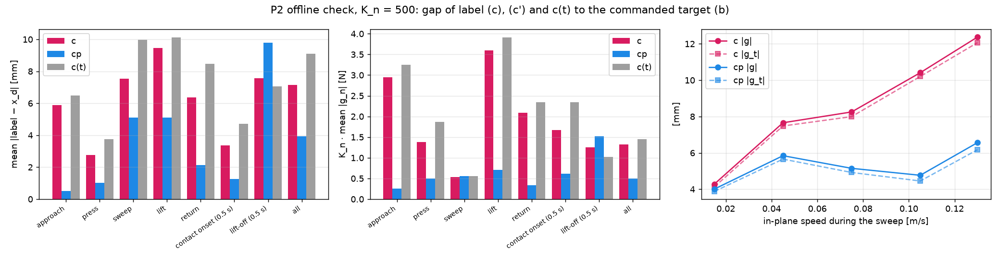

# Force-aware wiping with a Cartesian-impedance iiwa (MIT 6.4212, Fall 2026)

Team: Yanchuan Tang, Linda Yinghui He, Yichuan Song.

Does the action label matter for a learned wiping policy under Cartesian impedance control, and
which label recovers the missing force? A Drake iiwa wipes tables of varying tilt and stiffness;
a scripted expert produces demonstrations; Diffusion Policies are trained on four labels built
from the same demonstrations: (a) measured pose, (b) commanded target, (c) force-compensated
target, (c′) force + damping compensated.

Every section below folds: click a ▸ heading to open or close it.

- Dataset (Hugging Face): [`Lo-Fi-gahara/wipe-labels`](https://huggingface.co/datasets/Lo-Fi-gahara/wipe-labels)
- Model weights (Hugging Face, after training): `Lo-Fi-gahara/wipe-dp`

<details open>
<summary><h2>Nov 6 milestone checklist</h2></summary>

| Milestone item | Where | Status |
|---|---|---|
| Scripted program wipes reliably on all training tables | `scripts/gen_demos.py`; [Dataset statistics](#dataset-statistics) | done: 1296/1296 demos at K_n = 250 / 500 / 1000, no expert failure |
| Demonstrations collected and all labels built | `scripts/export_dataset.py` → CSV with a / b / c / c′ in every row; on Hugging Face | done: [`Lo-Fi-gahara/wipe-labels`](https://huggingface.co/datasets/Lo-Fi-gahara/wipe-labels) |
| Offline P2 check | `scripts/p2_offline_check.py`, `results/p2/`, `results/figures/p2_offline_gap.png` | done, see "P2 offline check" |
| First policy trained and evaluated in closed loop | `diffusion_policy/` (training, inference, Drake evaluation), `diffusion_policy/colab_train.ipynb` | code done and smoke-tested locally; full training of label (c) on Colab next |

<details>
<summary><b>Oct 30 milestone checklist (done)</b></summary>

| Milestone item | Where | Status |
|---|---|---|
| Impedance-controlled iiwa with the ball tool | `wipe/sim.py` (plant, tool, contact), `wipe/controllers.py` (`ImpedanceController`), gains in `wipe/config.py` | done |
| Tilted tables with adjustable k_e | `wipe/config.py` (`TableSpec`, `TRAIN_TABLES`, `OOD_TABLES`), `wipe/scene.py` (seeded scenes) | done |
| Logging of x_t, ẋ_t, f_t, x_{d,t}, u_t | `wipe/rollout.py` (episode dict, 20 Hz), example log `results/milestone/flat_episode.npz` | done |
| Scripted wiping program wipes a flat table | `wipe/expert.py`, `wipe/paths.py`, `wipe/coverage.py`; figure + videos in "Results" | done (also on tilted tables) |

</details>

</details>

<details open>
<summary><h2>Installation and downloads</h2></summary>

The repository holds code, small results and figures only. The dataset (366 MB) and the model
weights are on Hugging Face and are downloaded after cloning (`data/`, `runs/` and `*.pt` are
git-ignored).

```bash
git clone https://github.com/YourSaDady/wiping_model.git && cd wiping_model
uv venv --python 3.12 .venv && source env.sh      # uv downloads 3.12 if needed; always `source env.sh` from the repo root
uv pip install drake==1.58.0 numpy scipy matplotlib pandas tqdm pytest torch huggingface_hub
pytest tests/                                     # 13 tests

# dataset -> data/hf/wipe-labels/  (all three K_n folders; add --include "K500/*" --include "scenes/*" for the main one only)
hf download Lo-Fi-gahara/wipe-labels --repo-type dataset --local-dir data/hf/wipe-labels

# trained policies -> runs/<run name>/  (config.json, log.csv, ema_best.pt, ...)
hf download Lo-Fi-gahara/wipe-dp --local-dir runs                          # all runs
hf download Lo-Fi-gahara/wipe-dp --include "K500_c_s0/*" --local-dir runs  # one run
```

Training code also takes the dataset repo id directly (`--data Lo-Fi-gahara/wipe-labels`), and
downloads it into the Hugging Face cache. Training needs only `torch numpy pandas huggingface_hub`
(no Drake), so it runs on Colab (`diffusion_policy/colab_train.ipynb`).

Uploading (maintainers, needs a write token: `hf auth login`):

```bash
python scripts/upload_dataset_hf.py --repo Lo-Fi-gahara/wipe-labels                     # data/hf/wipe-labels/
python scripts/upload_runs_hf.py --repo Lo-Fi-gahara/wipe-dp --runs runs/K500_c_s0 [--steps 40000]
```

`upload_runs_hf.py` uploads only `config.json`, `log.csv`, `best.json`, `ema_best.pt` and the
snapshots named in `--steps`. It does not upload all 20 snapshots of 263 MB each.

<details>
<summary><b>Quick commands</b></summary>

```bash
python scripts/try_expert.py tilt00_ke2e4 0      # one scripted episode, prints metrics per phase
python scripts/watch_expert.py tilt00_ke2e4 0    # same, live in Meshcat + live top view
python results/fig_milestone_log.py             # logged-signal figure + results/milestone/flat_episode.npz
python scripts/phase1_checks.py --n 50          # expert on 50 dev scenes per table
python results/fig_phase1_replay_force.py
# Nov 6: regenerate the dataset (instead of downloading it), P2, Diffusion Policy
python scripts/gen_demos.py --K 500 --n 36 && python scripts/gen_demos.py --K 500 --split test --n 10
python scripts/export_dataset.py --K 500 250 1000 && python scripts/p2_offline_check.py --K 500 250 1000
python -m diffusion_policy.train --data data/hf/wipe-labels --K 500 --label c --out runs/K500_c_s0
python -m diffusion_policy.eval --run runs/K500_c_s0 --split val --tables train --n 10
```

</details>

</details>

<details>
<summary><h2>Environment, controller and task</h2></summary>

<details>
<summary><h3>Environment</h3></summary>

- KUKA iiwa14 (`drake_models`, no collision geometry) with a rigid ball tool: radius R = 2 cm,
  0.3 kg, centre 0.17 m along `iiwa_link_7` +z.
- Discrete `MultibodyPlant`, 1 ms step, point contact; ball–table stiffness k_e (each geometry gets
  2 k_e, which combine in series to k_e), Hunt–Crossley dissipation 20 s/m, Coulomb μ = 0.3.
- Tables: tilt about world x, any tilt and k_e. Training set tilt ∈ {0°, 10°, 20°} ×
  k_e ∈ {500, 2e3, 2e4, 1e5} N/m; held-out tables (15°, 5e4), (28°, 2e4), (28°, 500), (0°, 250), (10°, 3e5).
- Scenes (table height and position, region corner p0 and side L ∈ [13, 17] cm, wiping speed,
  start pose) are drawn from `SeedSequence([crc32(table), split, index])`; demo/val/test/dev
  splits never share a seed.

</details>

<details>
<summary><h3>Controller</h3></summary>

τ = Jᵀ [K_rot e_R − D_rot ω ; K (x_d − x) − D ẋ] − τ_g + N τ_null, with translational K, D diagonal in
the table frame (t1, t2, n): K_t = 1000 N/m, K_n = 500 N/m (250 and 1000 also supported), D_t = 110,
D_n = 250 N·s/m, K_rot = 100, D_rot = 10, null-space K = 5, D = 1. Every choice and the reason for it
is in `DECISIONS.md`.

</details>

<details>
<summary><h3>Logged signals (20 Hz, zero-order hold of x_d)</h3></summary>

`run_expert` / `replay_targets` / `run_hybrid` in `wipe/rollout.py` return

- `t`, `x` (ball centre), `xdot`, `f` (contact force on the tool, +n when pressing), `q` (joints),
  `u` (online uncovered fraction of the region), each with T+1 rows;
- `x_d` (commanded impedance target, T rows) and the expert `phase`;
- `samples` (100 Hz: t, region coordinates u1 u2, gap, f_n, friction power P_fric) used by the
  coverage metric, and `metrics`.

</details>

<details>
<summary><h3>Scripted wiping program and scenes</h3></summary>

The expert runs five phases:

1. **Approach** at 2 cm/s, slowing to 6 mm/s within 2 cm of the surface.
2. **Press**: an integrator on the force error drives the target down.
3. **Sweep** a 6-lane boustrophedon path over the L × L region. The path speed drops to 0.35 v
   within 2 cm of each corner.
4. **Lift** until the ball is 2 cm above the surface.
5. **Return**: the target moves straight back to the start position at 5 cm/s. The episode ends
   once the ball has settled there.

The target stays below the surface by f/K, so the spring produces the desired 10 N. The expert
regulates the **normal force** (f_des = 10 N on every demo); the target depth is whatever that force
needs on the given table.

The return phase brings the arm back to its start pose:

- the ball ends within 4.3 mm of the start position;
- the joints end within 2.5° of q_0 (median 1.3°), since the orientation and the weak null-space
  posture are held.

This was checked on 3 dev scenes × 17 tables: all 51 episodes succeeded and finished. The return
adds 2.8–3.9 s; the longest episode is now 43 s, under T_MAX = 50 s.
`ScriptedExpert(..., return_home=False)` restores the old ending.

**Scenes.** A *table* (e.g. `tilt20_ke1e5`) fixes the surface: tilt and k_e. A *scene* is one
randomized episode setup on that table (`wipe/scene.py: make_scene(table, split, index)`). It fixes:

- the table's position and height;
- the wiping region (corner p0, side L);
- the wiping speed v;
- the start pose.

The scene is drawn deterministically from the seed of (table, split, index), so the same triple
always gives the same scene. The splits `demo`, `val`, `test` and `dev` use disjoint seeds:
demonstrations, validation, the final test and debugging never share a scene.

</details>

<details>
<summary><h3>Success criterion</h3></summary>

A trial **succeeds** if, at the end of the episode,

1. the **uncovered fraction u_T ≤ ε_u = 0.1**, and
2. the **normal force never exceeded f_max = 20 N** (checked at 1 kHz, `PeakForceMonitor`).

The uncovered fraction comes from a 2 mm grid over the L × L region (`wipe/coverage.py`). Each cell
collects a **wiping dose**, the friction work done while the cell was under the wiping patch:

$$W_\text{cell} = \sum_{k\,:\;\|c_k - \text{cell}\| \le r} P_k\,\Delta t, \qquad
P_k = \max\bigl(0,\; -f_{t,k}\cdot v_{t,k}\bigr)$$

- c_k is the contact point (ball centre projected onto the undeformed surface), sampled at 100 Hz,
  and r = r_wipe = 2 cm is the radius of the virtual wiping patch.
- f_t is the tangential part of the measured contact force on the tool, and v_t is the tangential
  velocity of the ball's contact point. So P_k is the power dissipated by friction, |f_t|·|v_t| while
  sliding.
- A cell counts as **wiped** once **W_cell ≥ w_min = 0.06 J**, and u_T is the fraction of cells that
  are not.

**Threshold.** w_min = μ · f_min · 2r = 0.3 × 5 N × 4 cm. In words, a cell is clean once the patch
has slid one full patch diameter over it at the minimum force f_min = 5 N. The value is calibrated
against the proposal's f_min: the expert was run with a lowered force set point f_des on 8 tables ×
3 scenes, and its success rate under each candidate w_min was:

| expert f_des | 3 N | 4 N | 5 N | 6 N | 7 N | 10 N |
|---|---|---|---|---|---|---|
| w_min = 0.03 J (μ f_min r) | 0.50 | 0.88 | 0.92 | 1.00 | 1.00 | 1.00 |
| **w_min = 0.06 J (μ f_min 2r)** | **0.00** | **0.00** | **0.00** | **0.58** | **0.88** | **1.00** |

With 0.03 J the lanes overlap enough that wiping at 3–4 N passes, which would hide the force loss
that P1 is about. With 0.06 J, wiping at f_n ≤ f_min fails, as in the proposal's rule.

Why friction work and not a force threshold. Removing dirt takes pressure **and** sliding: by
Archard's wear law, worn volume ∝ normal load × sliding distance, and friction work is μ times that.
So this metric

- gives no credit for pressing in place (the press phase) or for sliding without load;
- lets a light pass be made up by passing again, while a pass that is too fast or too light does not
  finish a cell;
- uses the measured contact force, so it needs no knowledge of μ or of the table.

The proposal's original rule is still available: set `coverage_mode="force"` in `TaskParams`
(`wipe/config.py`). Under that rule a cell is wiped at the first 100 Hz sample with f_n ≥ f_min that
puts it under the patch. The force bound (2) is the same in both modes.

**Check with the work criterion** (Oct 29, 5 dev scenes × 17 tables):

- the scripted expert succeeds on 85/85, with worst u_T = 0.008;
- the cells it reaches get 1.1–1.7 w_min at the 5th percentile, with the lowest margin on the
  k_e = 3e5 OOD table.

The 50-scene numbers under "Results" were computed with the original force rule.

</details>

</details>

<details>
<summary><h2>Scripted demo: live view and failure cases</h2></summary>

`scripts/watch_expert.py` runs the scripted expert on one scene with two live views:

- **Meshcat:** the robot, the region, the planned lanes and the wiped cells in white. It can be
  replayed afterwards. The dirty region is drawn in the same pink as the top view.
- **Top view of the region:** each cell is coloured by W_cell / w_min. **Any pink shade means not
  wiped yet** (deep pink = no dose, paler = cleaner), and **white means wiped**.

The panel next to the top view lists the scene parameters and the live success checks: u vs ε_u,
1 kHz peak f_n vs f_max, and time vs the 50 s limit. The final verdict and its reasons are shown
there and printed.

```bash
python scripts/watch_expert.py [table] [index] [options]     # default: tilt00_ke2e4, dev scene 0
```

| option | meaning | default |
|---|---|---|
| `table index` | preset table (`wipe/config.py` TABLES) and scene index; fixes position, height, start pose | `tilt00_ke2e4 0` |
| `--split` | scene split (`demo`, `val`, `test`, `dev`) | `dev` |
| `--tilt` | table tilt about world x [deg] | from the preset |
| `--ke` | contact stiffness k_e [N/m] | from the preset |
| `--mu` | Coulomb friction of ball and table | 0.3 |
| `--v` | wiping speed along the lanes [m/s] | sampled per scene (0.05–0.12) |
| `--fdes` | normal force the expert holds [N] | 10 |
| `--L` | side of the square region [m] | sampled per scene (0.13–0.17) |
| `--K` | controller normal stiffness K_n [N/m] (250 / 500 / 1000) | 500 |
| `--rate` | real-time factor (0 = as fast as possible) | 1 |
| `--no-meshcat`, `--no-topview`, `--save-topview PNG` | display / output | |

The options change the scene or the expert, never the success test: f_min, f_max, ε_u, w_min,
r_wipe and the 50 s limit stay the task's.

Ball "hardness" is not a separate option. In point contact the ball and the table are two springs
in series, and only their combined stiffness k_e enters the dynamics (`DECISIONS.md`), so `--ke`
covers both.

**Failure cases.** Each command changes one thing from the nominal scene (`tilt00_ke2e4`, dev 0:
L = 15.6 cm, v = 0.066 m/s). Results are from Oct 29 runs with the default task parameters.

| case | command | u_T | peak f_n | result and cause |
|---|---|---|---|---|
| nominal | `python scripts/watch_expert.py` | 0.001 | 10.6 N | success |
| force too low | `python scripts/watch_expert.py --fdes 4` | 0.89 | 4.5 N | **fail** (coverage): friction work per pass below w_min; cells stay pink |
| force at f_min | `python scripts/watch_expert.py --fdes 5` | 0.58 | 5.5 N | **fail** (coverage): borderline cells between lanes are not finished |
| force barely enough | `python scripts/watch_expert.py --fdes 6` | 0.045 | 6.6 N | success (control case: just above the threshold) |
| force too high | `python scripts/watch_expert.py --fdes 25` | 0.00 | 25.6 N | **fail** (force): the region is wiped but f_n > f_max |
| table too hard | `python scripts/watch_expert.py --ke 1e6` | 0.00 | 24.7 N | **fail** (force): impact spike at contact, ≈ v·√(k_e m_eff) |
| table too soft | `python scripts/watch_expert.py --ke 100` | 1.00 | 8.5 N | **fail** (coverage + time): 10 N needs 10 cm of penetration, so the force never builds up |
| moving too fast | `python scripts/watch_expert.py --v 0.4` | 0.55 | 25.8 N | **fail** (both): the arm cuts corners, leaves gaps, and hits the surface when it reverses |
| moving too slow | `python scripts/watch_expert.py --v 0.01` | 0.72 | 10.1 N | **fail** (time): only part of the lanes is done in 50 s |
| slippery surface | `python scripts/watch_expert.py --mu 0.05` | 1.00 | 10.5 N | **fail** (coverage): full force but almost no friction work; would pass under the old force rule |
| region too large | `python scripts/watch_expert.py --L 0.30` | 0.40 | 10.9 N | **fail** (coverage): 6 lanes at s = 6 cm > 2r leave unwiped strips |
| very steep table | `python scripts/watch_expert.py --tilt 60` | 0.00 | 10.9 N | success: not a failure for the expert, since gains are in the table frame (IK works up to at least 70°) |

Add `--no-meshcat --rate 0 --save-topview out.png` to run a case without the windows.

</details>

<details>
<summary><h2>Data</h2></summary>

<details>
<summary><h3>Action labels</h3></summary>

All labels are built from the **same** logged episode (`wipe/labels.py:
make_labels(x, xdot, f, x_d, K, D, which)`). K and D are the controller's 3×3 world-frame stiffness
and damping for that episode, `Gains.K(n)` and `Gains.D(n)` of `GAINS_BY_KN[K_n]`.

| label | in the text | code name (`--label`, CSV columns) | formula | meaning |
|---|---|---|---|---|
| (a) | measured pose | `a` | x_{t+1} | where the ball actually went: what most datasets log |
| (b) | commanded target | `b` | x_{d,t} | what the controller was told; the target sits below the surface by about f/K |
| (c) | force-compensated target | `c` | x_{t+1} − K⁻¹ f_{t+1} | quasi-static reconstruction of (b) from pose and force sensing |
| (c′) | force + damping compensated | `cp` | x_{t+1} + K⁻¹ (D ẋ_{t+1} − f_{t+1}) | adds the damping term the static formula ignores (P2) |

**Observation** (same for every label, `wipe/data.py: obs_vector`, 16 numbers):
o_t = (x_t, ẋ_t, f_t, p0, L, n̂).

</details>

<details>
<summary><h3>CSV dataset (on Hugging Face)</h3></summary>

`scripts/export_dataset.py` writes one folder, `data/hf/wipe-labels/` (366 MB). It is uploaded as
[`Lo-Fi-gahara/wipe-labels`](https://huggingface.co/datasets/Lo-Fi-gahara/wipe-labels):

```
README.md                  dataset card (HF configs K500 / K250 / K1000, statistics)
K{K_n}/train.csv           32 demos per training table, 12 tables     -> policy training
K{K_n}/val.csv             the next 4 demos per training table        -> offline validation (convergence, checkpoints)
K{K_n}/test.csv            expert on test scenes 0-9 of all 17 tables -> offline test (incl. 5 held-out tables)
K{K_n}/episodes.csv        one row per episode: scene (table, tilt, k_e, p0, L, n, t1, t2, v, start), expert metrics
scenes/val.csv, test.csv   closed-loop evaluation scenes: 10 val per training table, 50 test per table (17)
stats.json, stats.md       the statistics below
```

Splits are by episode and by scene seed:

- train and val are different demo scenes of the same tables;
- test uses the `test` split seeds, and the closed-loop test runs on these same scenes, so the
  expert rows in `test.csv` are also the privileged reference on them.

Policies are trained on train only.

There is one row per 20 Hz step t of an episode. The final state sample is only used inside the
labels.

| columns | meaning |
|---|---|
| `episode_id`, `step`, `t`, `phase` | episode key `K500_tilt10_ke2e4_demo003`, step index, time [s], expert phase 0–4 (approach, press, sweep, lift, return; not an observation) |
| `x_x x_y x_z`, `xdot_*`, `f_*` | x_t, ẋ_t, f_t (world frame; f is the force on the tool) |
| `p0_*`, `L`, `n_*` | region corner, side, table normal (constant per episode) |
| `fn`, `u` | n̂·f_t, uncovered fraction so far (diagnostics, not observations) |
| `a_*`, `b_*`, `c_*`, `cp_*` | the four labels for step t, world frame [m] |

To regenerate it instead of downloading:

```bash
python scripts/gen_demos.py --K 500 --n 36                 # demos (also --K 250, --K 1000), ~1 min each on 16 workers
python scripts/gen_demos.py --K 500 --split test --n 10    # expert on test scenes, all 17 tables
python scripts/export_dataset.py --K 500 250 1000          # -> data/hf/wipe-labels/
```

`gen_demos.py` first writes one `.npz` per episode, to `data/demos/K{K_n}/{table}/{index:03d}.npz`,
or `data/expert_test/...` for the test split. Each file holds:

- `t`, `x`, `xdot`, `f`, `q`, `u` (T+1 rows) and `x_d`, `phase` (T rows);
- `samples` (100 Hz coverage samples), plus `metrics` and `scene` as JSON.

Failed expert demo episodes are skipped and never used for training.

</details>

<details>
<summary><h3 id="dataset-statistics">Dataset statistics (collected Nov 5)</h3></summary>

**Demo settings.** Demos are collected on the 12 training tables: tilt {0°, 10°, 20°} × k_e
{500, 2e3, 2e4, 1e5} N/m, at three controller stiffnesses K_n ∈ {**500** (main), 250, 1000}. The
250 and 1000 sets are for the K sweep (P1, P3).

Varied per demo, from the scene seed:

- region centre x ∈ U[0.52, 0.60] m, y ∈ U[−0.04, 0.04] m, height ∈ U[0.06, 0.16] m;
- region side L ∈ U[0.13, 0.17] m;
- wiping speed v ∈ U[0.05, 0.12] m/s;
- start 4–7 cm above the surface, with ±1 cm in-plane jitter.

Shared by every demo:

- task: f_des = 10 N, the success test above, T_MAX = 50 s;
- physics: μ = 0.3, ball R = 2 cm;
- controller: K_t = 1000, D_t = 110, D_n = 250;
- timing: 1 ms plant step, 20 Hz expert and logging with zero-order hold.

All 1296 demo episodes (12 tables × 36 × 3 gains) succeeded on the first try, so the kept demos are
scene indices 0–35 on every table.

| K_n | split | episodes (tables) | steps (20 Hz) | hours | duration mean [min, max] s | expert success | mean u_T | f_n sweep mean ± std [N] | max peak f_n [N] |
|---|---|---|---|---|---|---|---|---|---|
| 500 | train | 384 (12) | 228,531 | 3.17 | 29.8 [21.4, 42.5] | 1.000 | 0.0006 | 9.98 ± 0.37 | 13.1 |
| 500 | val | 48 (12) | 28,058 | 0.39 | 29.2 [21.9, 39.8] | 1.000 | 0.0006 | 9.98 ± 0.37 | 12.2 |
| 500 | test | 170 (17, 50 OOD) | 100,517 | 1.40 | 29.6 [21.7, 42.2] | 1.000 | 0.0010 | 9.98 ± 0.40 | 16.2 |
| 250 | train | 384 (12) | 234,440 | 3.26 | 30.5 [22.2, 43.2] | 1.000 | 0.0005 | 9.99 ± 0.38 | 15.0 |
| 250 | val | 48 (12) | 28,800 | 0.40 | 30.0 [22.5, 40.1] | 1.000 | 0.0005 | 9.99 ± 0.37 | 15.7 |
| 250 | test | 170 (17, 50 OOD) | 103,061 | 1.43 | 30.3 [22.6, 42.6] | 0.941 | 0.0009 | 9.99 ± 0.41 | 24.2 |
| 1000 | train | 384 (12) | 228,673 | 3.18 | 29.8 [21.2, 42.8] | 1.000 | 0.0008 | 9.97 ± 0.35 | 13.0 |
| 1000 | val | 48 (12) | 28,074 | 0.39 | 29.2 [21.9, 40.4] | 1.000 | 0.0008 | 9.97 ± 0.35 | 12.2 |
| 1000 | test | 170 (17, 50 OOD) | 100,707 | 1.40 | 29.6 [21.4, 42.8] | 1.000 | 0.0012 | 9.96 ± 0.39 | 16.2 |

The only expert failures are at K_n = 250 on the held-out hard table `tilt10_ke3e5`. All 10 test
scenes wipe the region but hit 20.3–24.2 N at contact onset (f_max = 20 N). They stay in `test.csv`,
with `success = False` in `episodes.csv`.

At K_n = 500 each training table contributes 32 episodes and 17.9k–20.3k steps (per-table numbers in
`stats.md` of the dataset). Phase share of the training steps:

| approach | press | sweep | lift | return |
|---|---|---|---|---|
| 15.3 % | 3.1 % | 63.2 % | 7.1 % | 11.3 % |

The next table shows where each label puts the target relative to the current ball position,
label_t − x_t. It is for K_n = 500, train split. Each cell gives the mean ± std along n̂ in mm, then,
after the semicolon, the mean in-plane distance in mm.

| label | approach | press | sweep | lift | return |
|---|---|---|---|---|---|
| (a) | −0.6 ± 0.3; 0.0 | −0.3 ± 0.3; 0.0 | −0.0 ± 0.0; 2.9 | +0.6 ± 0.5; 0.8 | +0.5 ± 0.4; 2.3 |
| (b) | −6.5 ± 3.1; 0.1 | −16.1 ± 4.6; 0.1 | −20.0 ± 1.2; 12.1 | +2.1 ± 11.6; 4.3 | +4.7 ± 3.2; 6.6 |
| (c) | −0.7 ± 0.9; 0.0 | −14.0 ± 4.9; 0.2 | −20.0 ± 0.7; 5.9 | −3.9 ± 6.3; 1.5 | +0.5 ± 0.4; 2.3 |
| (c′) | −6.8 ± 3.2; 0.0 | −16.6 ± 5.2; 0.2 | −20.0 ± 1.0; 12.1 | +2.6 ± 10.2; 3.2 | +5.3 ± 3.8; 7.3 |

What the table shows:

- **Sweep, depth.** (b), (c) and (c′) all sit f_des/K_n = 2 cm below the ball (4 cm at K_n = 250,
  1 cm at K_n = 1000), while (a) sits on it. This is the force a policy trained on (a) loses (P1).
- **What (c) misses.** It lacks the in-plane lead of the target (5.9 vs 12.1 mm, ≈ D_t v / K_t) and
  the downward lead during the approach. (c′) restores both.

</details>

</details>

<details>
<summary><h2>P2 offline check</h2></summary>

**Question.** Label (c) = x − K⁻¹f is built from pose and force alone. It ignores damping and
inertia. P2 predicts that (c) matches the true command (b) in steady wiping, but deviates:

- at contact onset;
- at lift-off;
- at high speed.

It also predicts that adding K⁻¹Dẋ, which gives (c′), closes most of the gap.

**Method** (`python scripts/p2_offline_check.py --K 500 250 1000`). Label (b) = x_{d,t} is the
target the controller actually received, so it is the **reference** (the zero line), not a baseline
policy. For every step of the train, val and test episodes we compute the gap between a
reconstructed label and the true command, g = label − x_{d,t}. Then we average over groups of steps:

- by expert phase;
- by event: the 0.5 s after the first contact, and the first 0.5 s of the lift;
- by in-plane speed during the sweep.

Four numbers per group:

| quantity | meaning |
|---|---|
| \|g\| | total gap [mm] |
| g_n | gap along n̂ [mm], signed; < 0 means the label is deeper than x_d |
| \|g_t\| | in-plane gap [mm] |
| K_n\|g_n\| | the normal force error [N] the gap would cause if the label replaced x_d against a rigid table. On a table of stiffness k_e it is K_eff\|g_n\|, with K_eff = K_n k_e/(K_n + k_e) ≤ K_n |

Only the normal part changes the wiping force. An in-plane gap shifts where the tool goes: it lags
or leads along the lane, but it does not change how hard the tool presses.

Outputs:

- full tables in `results/p2/K{K}_by_{phase,speed,table}.csv` and `results/p2/p2_report.md`;
- the figure `results/figures/p2_offline_gap.png`.



**How to read the figure** (K_n = 500, 602 episodes, 357k steps). The shorter the bar, the closer
the label is to what the controller was really told.

- **Left panel.**
  - x axis: groups of steps (the five phases, the two 0.5 s events, and "all").
  - y axis: mean total gap \|label − x_d\| in mm.
  - Bars: (c) pink, (c′) blue, and c(t) = x_t − K⁻¹f_t grey. c(t) is the proposal's formula with the
    force taken at the same step; ours uses step t+1.
- **Middle panel.**
  - Same groups and bars as the left panel.
  - y axis: K_n · mean\|g_n\|, the normal part of the gap converted to newtons. This is the panel
    that matters for wiping force.
- **Right panel.**
  - Sweep steps only, binned by the in-plane speed of the ball. The x axis is the bin centre in m/s.
  - y axis: mean gap in mm. Solid lines are the total gap \|g\|; dashed lines are the in-plane part
    \|g_t\|.
  - When dashed ≈ solid, the gap is almost entirely along the lane, not into the table.

| phase / event | (c) \|g\| [mm] | (c′) \|g\| [mm] | (c) K_n\|g_n\| [N] | (c′) K_n\|g_n\| [N] |
|---|---|---|---|---|
| approach | 5.89 | 0.52 | 2.95 | 0.25 |
| contact onset (0.5 s) | 3.36 | 1.26 | 1.67 | 0.62 |
| press | 2.77 | 1.01 | 1.38 | 0.50 |
| sweep | 7.55 | 5.12 | 0.53 | 0.56 |
| lift-off (0.5 s) | 7.55 | 9.80 | 1.26 | 1.52 |
| lift | 9.45 | 5.11 | 3.59 | 0.71 |
| return | 6.38 | 2.12 | 2.09 | 0.33 |
| all | 7.15 | 3.94 | 1.33 | 0.49 |

| in-plane speed in the sweep [m/s] | 0–0.03 | 0.03–0.06 | 0.06–0.09 | 0.09–0.12 | > 0.12 |
|---|---|---|---|---|---|
| (c) \|g\| [mm] | 4.28 | 7.66 | 8.25 | 10.41 | 12.37 |
| (c′) \|g\| [mm] | 4.01 | 5.84 | 5.15 | 4.77 | 6.56 |

**Reading off the conclusions.**

1. **Steady wiping: (c) ≈ (b) in force.**
   - Middle panel, "sweep": (c) and (c′) both give ≈ 0.5 N; the signed mean g_n is 0.07 mm.
   - The left panel still shows 7.6 mm for (c) in the sweep, but the right panel shows that this gap
     is in-plane (dashed ≈ solid).
   - So during wiping (c) presses as hard as (b), as P2 predicts. It only trails along the lane.
2. **The gap grows with speed and is in-plane.**
   - Right panel, pink: (c) rises from 4.3 to 12.4 mm as the speed goes from ≈ 0.015 to 0.13 m/s,
     roughly linearly.
   - That is the damping term D_t v/K_t (110 × 0.1/1000 ≈ 11 mm), which (c) omits.
   - Blue: (c′) contains that term and stays flat at 4–6.6 mm. The rest is inertia.
3. **Outside steady contact, (c) loses force.**
   - Middle panel, approach (2.95 N), lift (3.59 N) and return (2.09 N): (c) is far from (b),
     while (c′) is ≤ 0.7 N.
   - In the approach, f ≈ 0, so (c) ≈ x. The expert's target, however, leads the ball downward by
     D_n v/K_n. A policy trained on (c) is therefore never told to push down, which is the P4
     contact-onset question.
   - In the lift, (c) stays 6 mm too deep (signed g_n < 0, in the csv).
   - Contact onset: 1.67 N for (c) vs 0.62 N for (c′).
4. **Exception: the first 0.5 s of the lift.**
   - There (c′) is slightly worse than (c): 9.8 vs 7.6 mm, and 1.5 vs 1.3 N.
   - The contact releases and the ball accelerates. The remaining term is inertial, K⁻¹Λẍ, which
     neither label models.
5. **Same-step formula is worse.** The grey bars are above the pink ones in every group (all:
   9.09 vs 7.15 mm). Pairing the command x_{d,t} with the state it produced, x_{t+1}, is the better
   reconstruction.

Other results, from the CSV files only:

- **(a) is the P1 offset.** It sits 20 mm above x_d during the sweep, about 10.0 N.
- **K_n = 250 / 1000 show the same pattern.** The approach gap of (c) scales with 1/K_n: 12.8, 5.9
  and 2.6 mm at K_n = 250, 500 and 1000. The force-equivalent error stays ≈ 3 N.

The closed-loop half of P2, the success rate of (b) vs (c) vs (c′), comes with the trained policies.

</details>

<details>
<summary><h2>Diffusion Policy</h2></summary>

Everything is in `diffusion_policy/`:

| file | content |
|---|---|
| `dataset.py` | CSV loading (local folder or HF repo id), observation features, windows, min-max normalizer (numpy/pandas only) |
| `model.py` | 1D temporal U-Net with FiLM conditioning (Chi et al., RSS 2023) |
| `diffusion.py` | DDPM training schedule (100 steps, squared cosine, ε-prediction), DDIM sampler, EMA |
| `train.py` | training CLI: validation, checkpoints, resume, optional early stopping, `--amp` on CUDA |
| `policy.py` | `DiffusionPolicy` (load a run, predict target chunks), `NearestNeighborPolicy` (no training, harness check) |
| `eval.py` | closed-loop inference in Drake: batch evaluation on val/test scenes, or one episode with Meshcat + top view |
| `colab_train.ipynb` | Colab notebook: clone, download the HF dataset, train, plot the curves, upload the weights |

<details open>
<summary><h3>Inference: how a wiping motion is generated and executed</h3></summary>

```
 time ──────────────────────────────────────────────────────────────────────────────────────────►
 policy steps (20 Hz, Δt = 50 ms)
        t−1          t          t+1        t+2     · · ·     t+7         t+8
         │           │           │          │                 │           │
 ①  observe  o_{t−1}, o_t        o = (x, ẋ, f, p0, L, n̂)  16 numbers, from the simulated sensors
         └─────┬─────┘
               ▼
 ②  policy  ┌──────────────────────────────────────────────────────────────┐
    (one    │ c = normalize([o_{t−1}, o_t])                    32 numbers  │
     call   │ A ~ N(0, I)                     16 × 3, seeded (scene, call) │
     per    │ 16 DDIM steps, k = 90, 84, …, 6, 0:                          │
     0.4 s) │     ε̂ = ε_θ(A, k, c)         1D U-Net, FiLM on [emb(k), c]   │
            │     â₀ = (A − √(1−ᾱ_k) ε̂) / √ᾱ_k,  clip to [−1, 1]           │
            │     A  = √ᾱ_{k'} â₀ + √(1−ᾱ_{k'}) ε̂            (k' = k − 6)  │
            │ Δ_0 … Δ_15 = unnormalize(A)       offsets from x_t [m]       │
            │ x_{d,t+j} = x_t + Δ_j             world-frame targets        │
            └──────────────────────────────┬───────────────────────────────┘
                                           ▼
 ③  execute  │ x_{d,t} │ x_{d,t+1} │ x_{d,t+2} │ · · · │ x_{d,t+7} │   x_{d,t+8 … t+15} discarded
    (each target held 50 ms, zero-order hold)               │
                                                            └──► ① again at t+8 with (o_{t+7}, o_{t+8})
 ④  impedance controller, 1 kHz (50 updates per target):
        τ = Jᵀ [ K_rot e_R − D_rot ω ;  K (x_d − x) − D ẋ ] − τ_g + N τ_null
 ⑤  Drake MultibodyPlant, 1 ms: iiwa + ball tool + table (contact k_e, μ)
        → x, ẋ, f at every 50 ms step (the next observations) and coverage samples at 100 Hz
```

**The four policies differ only in what x_d means.**

- (b), (c) and (c′) learn targets that lie f/K below the surface, so the spring in ④ presses.
- (a) learns targets on the surface, so the spring in ④ barely presses.

The orientation and the null-space posture are held by the controller; the policy outputs positions
only. An episode runs until t_max = 50 s, with no early stop, and is then scored by the success
criterion.

</details>

<details>
<summary><h3>Inputs and outputs</h3></summary>

**Observation.** The same for every label (the proposal's o_t), over the last T_o = 2 steps:
o_t = (x_t, ẋ_t, f_t, p0, L, n̂), 16 numbers.

| input | why it is needed |
|---|---|
| x_t | where the tool is; actions are relative to it |
| ẋ_t | direction of travel along the lane (disambiguates the two directions of the same lane) and the dynamic state that (b)/(c′) depend on |
| f_t | contact state: whether and how hard the tool presses. It is the only way the policy can tell k_e and the table height. It is identical for all labels, so label effects are not input effects |
| p0, L | which region to wipe; varies per scene |
| n̂ | which way is "into the table"; varies with tilt |

Deliberately **not** inputs:

- **Images.** The state is fully observed and the geometry is given by (p0, L, n̂).
- **Joint angles q.** The controller handles them.
- **The previous command x_{d,t−1}.** It would leak label (b) into the input.
- **k_e and tilt.** Held-out tables must be handled from f and n̂.
- **The coverage u_t.** It is the privileged success measure. The team decided against a progress
  feature: `DECISIONS.md` on `yanchuan/full-pipeline`.

**Output.** A chunk of H = 16 target positions x_d (3-D) for the impedance controller, relative to
the current ball position: a_j = label_{t+j} − x_t. The first 8 are executed (0.4 s).

`--frame table` is an ablation. It feeds the same information in the region frame,
(R̂ᵀ(x − p0), R̂ᵀẋ, R̂ᵀf, L, n̂) with R̂ = [t1 t2 n̂], and predicts actions in that frame. This makes the
policy nearly tilt-invariant, which is relevant to P4.

</details>

<details>
<summary><h3>Training objective</h3></summary>

A training sample is a window from the training CSV: the observations O_t = (o_{t−1}, o_t) and the
action chunk A_t⁰ = (a_t, …, a_{t+15}), with a_j = label_{t+j} − x_t. Both are min-max normalized to
[−1, 1]; the last label repeats past the episode end. The noise-prediction network ε_θ is trained
with the DDPM loss (Ho et al. 2020; Chi et al. 2023):

$$
\mathcal{L}(\theta)=\mathbb{E}_{(O_t,A_t^0)\sim\mathcal{D},\;k\sim\mathcal{U}\{0,\dots,99\},\;\varepsilon\sim\mathcal{N}(0,I)}
\Big[\big\lVert\varepsilon-\varepsilon_\theta\big(\sqrt{\bar\alpha_k}\,A_t^0+\sqrt{1-\bar\alpha_k}\,\varepsilon,\;k,\;O_t\big)\big\rVert_2^2\Big]
$$

with the squared-cosine schedule

$$\bar\alpha_k=\prod_{i\le k}(1-\beta_i), \qquad \beta_i = \min\Big(1-\tfrac{g(i+1)}{g(i)},\,0.999\Big), \qquad g(s)=\cos^2\Big(\tfrac{s/100+0.008}{1.008}\cdot\tfrac{\pi}{2}\Big).$$

The loss is the mean squared error over the 16 × 3 chunk, averaged over a batch of 256. The weights
used for evaluation are an exponential moving average of θ. At inference the 16-step DDIM sampler in
the diagram above inverts this noising, conditioned on the current O_t.

</details>

<details>
<summary><h3>Model and training settings</h3></summary>

| | setting |
|---|---|
| network | Conditional 1D U-Net over the 16-step chunk, down dims (256, 512, 1024), kernel 5, GroupNorm 8, Mish; FiLM from [diffusion-step embedding (256), flattened 2 × 16 observation]; 65.7M parameters |
| diffusion | DDPM, 100 steps, squared-cosine schedule, ε-prediction, samples clipped to [−1, 1]; DDIM 16 steps (η = 0) at inference |
| normalization | per-dimension min-max to [−1, 1] over the training windows (observations and actions) |
| horizons | T_o = 2, H = 16, execute 8 |
| optimizer | AdamW lr 1e-4, wd 1e-6, β = (0.95, 0.999), batch 256, 500 warm-up steps then cosine; EMA (power 0.75, max 0.9999) |
| length | 40 000 steps ≈ 45 epochs of 228k windows (K_n = 500) |
| validation | Every 2 000 steps on the 48 held-out demos (`val.csv`). It reports the denoising loss and the error of DDIM chunks against the label: first action, the 8 executed actions, and the executed actions along n̂. Each evaluation saves `ema_<step>.pt`; the lowest executed-chunk error is also saved as `ema_best.pt` |
| inference noise | seeded by (scene seed, call index): every policy sees the same noise on the same scene |

The settings follow the Diffusion Policy low-dim defaults and the team's earlier decisions. Only
the label changes between the four runs.

</details>

<details>
<summary><h3>Training and evaluation workflow</h3></summary>

```bash
# train (GPU; also runs on MPS/CPU, slowly). --data: local folder or Lo-Fi-gahara/wipe-labels
python -m diffusion_policy.train --data data/hf/wipe-labels --K 500 --label c --seed 0 --out runs/K500_c_s0 [--amp]
# closed loop in Drake on the 120 validation scenes (checkpoint choice), then the test scenes
python -m diffusion_policy.eval --run runs/K500_c_s0 --ckpt best --split val --tables train --n 10
python -m diffusion_policy.eval --run runs/K500_c_s0 --ckpt 40000 --split test --tables all --n 50
# watch one episode (Meshcat + live top view, same display as scripts/watch_expert.py)
python -m diffusion_policy.eval --run runs/K500_c_s0 --watch tilt10_ke2e4 0 --split val
# harness check without training: nearest-neighbour lookup of training chunks
python -m diffusion_policy.eval --nn c --split val --tables train --n 1
```

**Run folder.**

- `config.json`: all arguments and the normalizers.
- `log.csv`, `best.json`.
- `ema_<step>.pt` and `ema_best.pt`: the EMA weights.
- `ckpt_last.pt`: full state, for resuming.

`eval.py` writes one JSON line of metrics per episode to `results/raw/<run>_<split>.jsonl`, and
resumes from it.

**Colab.** Open `diffusion_policy/colab_train.ipynb` on a GPU runtime. A T4 (16 GB) is plenty:

- **Memory.** The 65.7M model with its gradients, Adam state and EMA takes ≈ 1.3 GB, and < 3 GB
  with activations, so even a 4 GB GPU fits.
- **Time.** About 1.5–2 h per 40k-step run, or less with `--amp`. This is an estimate from the
  team pilot's 38 ms/step on an A6000.
- **Disconnects.** Runs are written to Google Drive and resume after a disconnect.
- **Weights.** The last cells upload them to `Lo-Fi-gahara/wipe-dp`.

Closed-loop evaluation needs many CPU cores for Drake, so download the run and evaluate locally.

**Validation and stopping.** Keep the validation demos to watch convergence, but do not early-stop
on them by default (`--patience 0`).

- The denoising loss is a poor proxy for closed-loop success.
- Train the fixed budget and pick the checkpoint by closed-loop success on the 120 `val` scenes.
- Test scenes are used only for the final numbers.

**Local smoke test (Nov 5, M5 Max, MPS).**

- **Training.** 800 steps of a 5.4M-parameter U-Net on 48 episodes: the validation chunk error
  fell 37 → 18 mm, and resume works.
- **Closed loop.** 4 val episodes ran end to end; they fail, as expected after 800 steps.
- **Nearest-neighbour harness check**, one val scene per training table:

  | label | success | mean f_n |
  |---|---|---|
  | (c) | 7/12 | 8.1 N |
  | (a) | 0/12 | 0.6 N (P1) |

- **Speed.** The full model runs at ≈ 0.8 s/step on MPS, too slow for full runs, hence Colab.

</details>

</details>

<details>
<summary><h2>Results</h2></summary>

- **`pytest tests/`: 13 tests pass.**
  - `tests/test_dp.py`: observation order, window alignment, table-frame round trip, policy
    save/load with batch-independent noise.
  - `tests/test_core.py`: label formulas and time alignment, table-frame gains, lane-path coverage,
    the two coverage modes, force sign, springs in series.
- **Scripted program, 50 dev scenes per table** (`scripts/phase1_checks.py --n 50`,
  `results/phase1/expert_check_summary.csv`): success 50/50 on every table and gain tested.
  Flat tables at K_n = 500:

  | table | success | max peak f_n [N] | mean f_n while wiping [N] |
  |---|---|---|---|
  | tilt00_ke500 | 50/50 | 11.47 | 8.68 |
  | tilt00_ke2e3 | 50/50 | 11.50 | 8.96 |
  | tilt00_ke2e4 | 50/50 | 12.37 | 9.02 |
  | tilt00_ke1e5 | 50/50 | 12.41 | 9.03 |
  | tilt00_ke250 (held out) | 50/50 | 11.20 | 8.35 |

- **Demonstrations and P2:** see "Data" and "P2 offline check" above.
- **One logged flat-table episode** (tilt00_ke2e4, dev scene 0):
  `results/figures/milestone_flat_log.png`.
- **Videos of the scripted program on flat tables:** `results/videos/tilt00_ke500_000_scripted.mp4`
  and `results/videos/tilt00_ke1e5_000_scripted.mp4`.
- **Open-loop replay of the action labels:** `results/figures/phase1_replay_force.png`.

</details>

<details>
<summary><h2>Notes and attribution</h2></summary>

- The hybrid force/position baseline (`scripts/eval_baselines.py`) is from the earlier pipeline on
  `yanchuan/full-pipeline`.
- The Diffusion Policy code from that branch (`wipe/dp/`, `scripts/train_dp.py`,
  `scripts/eval_policy.py`) has moved to `diffusion_policy/` and now trains from the CSV dataset.
- `STATUS.md` and `DECISIONS.md` are as of the Oct 30 snapshot.

Attribution:

- Drake (Tedrake et al.) for simulation and IK; the iiwa14 model from `drake_models`.
- Controllers follow the course textbook (Tedrake, *Robotic Manipulation*, Ch. 8).
- The 1D U-Net, FiLM conditioning and training recipe follow Chi et al., "Diffusion Policy", RSS 2023
  (re-implemented). DDPM: Ho et al. 2020; DDIM: Song et al. 2021; cosine schedule: Nichol & Dhariwal
  2021.
- The code was written with an AI coding agent (Claude, Anthropic) from the team's design brief.

</details>
